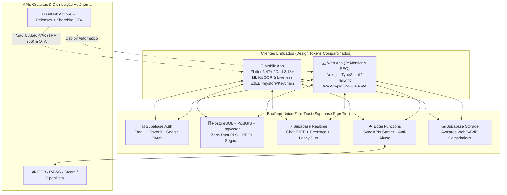

# 🎮💜 NEXUS DUO

### *Seu Duo no Jogo. Seu Match na Vida.*

**Aplicativo de relacionamento gamer de alto padrão — Mobile (Flutter) & Web (Next.js) unificados por arquitetura Zero-Trust no Supabase, IA/OCR on-device e custo zero de infraestrutura no MVP.**

---

## 🎯 Visão do Produto

O **NEXUS DUO** nasce para resolver a maior frustração do público gamer nos aplicativos de relacionamento tradicionais: **fadiga de swipe, conversas rasas, ghosting, perfis falsos e ambientes tóxicos**.

Em vez de forçar encontros frios baseados apenas em fotos, o NEXUS DUO transforma o que gamers mais amam — **jogar juntos** — no primeiro passo natural de uma conexão afetiva real:

- **🧬 Gamer DNA & Match Inteligente:** Algoritmo híbrido que combina busca vetorial (`pgvector`), Programação Dinâmica de compatibilidade de horários de jogo e afinidade de biblioteca/estilo (competitivo, casual, cozy, cooperativo).
- **🕹️ Lobby "Duo Agora" (Primeiro Date sem Fricção):** Salas efêmeras de 2 horas para chamar seu match para uma partida rápida antes mesmo de marcar um café.
- **🛡️ Anti-Catfish & Rank Verificado (Custo Zero On-Device):** Verificação facial de vivacidade (*Selfie Liveness*) e leitura de prints de rank/gamertag por **OCR 100% no dispositivo** (Google ML Kit / MediaPipe / Tesseract.js).
- **🔐 Privacidade & Criptografia de Ponta a Ponta (E2EE):** Mensagens privadas protegidas com troca de chaves `X25519` + cifragem autenticada `AES-256-GCM`, geolocalização com *fuzzing* de segurança e políticas **Row Level Security (RLS)** estritas no Supabase.
- **📱 Mobile + 💻 Web Segundo Monitor:** Aplicativo nativo em **Flutter** no celular caminhando lado a lado com a plataforma **Web em Next.js** otimizada para SEO e uso no segundo monitor do PC durante filas de partidas.
- **🚀 Atualização Autônoma no Celular:** Releases automatizadas via **GitHub Actions + GitHub Releases** com atualização *Over-The-Air* (Shorebird) e verificador nativo de APK com validação criptográfica `SHA-256`.

---

## 🏗️ Arquitetura de Alto Nível

---

## 📚 Documentação Completa de Engenharia & Produto

Toda a fundação do **NEXUS DUO** foi estruturada com rigor multidisciplinar sênior. Navegue pelos documentos abaixo:

| # | Documento | Escopo Principal |
|---|---|---|
| 00 | [Índice Mestre](./docs/00_INDICE_MESTRE.md) | Mapa completo da arquitetura, produto e ordem de leitura |
| 01 | [Proposta de Valor e Negócio](./docs/01_PROPOSTA_DE_VALOR_E_NEGOCIO.md) | Value Proposition Canvas, Lean Canvas, mercado, concorrência, Unit Economics (R\$ 0 no MVP) |
| 02 | [Personas e Mapa de Empatia](./docs/02_PERSONAS_E_MAPA_DE_EMPATIA.md) | 4 personas detalhadas, mapas de empatia e jornadas ponta a ponta |
| 03 | [Psicologia e Retenção](./docs/03_PSICOLOGIA_E_RETENCAO.md) | SDT, Modelo Hooked ético, anti-swipe fatigue, anti-ghosting, segurança feminina e métricas North Star |
| 04 | [Design System e UX/UI](./docs/04_DESIGN_SYSTEM_E_UX_UI.md) | Estética *Cyber-Velvet & Obsidian Neon*, tipografia matemática, responsividade, telas e micro-interações |
| 05 | [Arquitetura de Software](./docs/05_ARQUITETURA_DE_SOFTWARE.md) | ADR-001 (Flutter + Next.js), Clean Architecture, OOP (Polimorfismo, Encapsulamento, SOLID) e estrutura de pastas |
| 06 | [Banco de Dados Supabase e Segurança](./docs/06_BANCO_DE_DADOS_SUPABASE_E_SEGURANCA.md) | DER completo, SQL com RLS Zero-Trust, `PostGIS`, `pgvector`, E2EE (`X25519 + AES-256-GCM`) e LGPD |
| 07 | [IA, ML, OCR e Algoritmos de Match](./docs/07_IA_ML_OCR_E_ALGORITMOS_MATCH.md) | Match híbrido, Programação Dinâmica de horários, análise de complexidade $O(\cdot)$, Liveness e OCR on-device |
| 08 | [Inovações Custo Zero e APIs](./docs/08_INOVACOES_CUSTO_ZERO_E_APIS.md) | Funcionalidades diferenciadoras de R\$ 0, integração IGDB/RAWG/Steam/Discord/OpenDota e cache inteligente |
| 09 | [MVP e Product Backlog](./docs/09_MVP_E_PRODUCT_BACKLOG.md) | Escopo MoSCoW (MVP vs V1.5 vs V2.0), Épicos, User Stories em Gherkin e Sprints |
| 10 | [Qualidade, Testes e DevOps CI/CD](./docs/10_QUALIDADE_TESTES_E_DEVOPS_CICD.md) | Pirâmide de testes, Golden Tests responsivos, pgTAP/RLS, Playwright, CI/CD e Auto-Update no celular |
| 11 | [Ambiente VSCode e Instalação](./docs/11_AMBIENTE_VSCODE_E_INSTALACAO.md) | Setup Windows 11, Linux e macOS, extensões VSCode, comandos de instalação e checklist de chaves gratuitas |
| 🚀 | [Prompt Mestre de Execução](./docs/PROMPT_MESTRE_EXECUCAO.md) | Prompts prontos (Mestre + Multi-Agentes) e guia de modelos/comandos para implementação autônoma no Antigravity |

---

## 🛠️ Stack Tecnológica (Custo Zero para MVP, Pronta para Escala)

- **Mobile:** Flutter `3.47+` / Dart `3.13+`, Riverpod, GoRouter, Dio, Freezed, `supabase_flutter`, `google_mlkit_face_detection`, `google_mlkit_text_recognition`, `cryptography`, `flutter_secure_storage`.
- **Web:** Next.js (App Router), React, TypeScript (strict), Tailwind CSS, Framer Motion, `@supabase/ssr`, Web Crypto API.
- **Backend & DB:** Supabase (PostgreSQL 15+, PostGIS, `pgvector`, Row Level Security, Auth, Realtime, Edge Functions em Deno, Storage).
- **CI/CD & Distribuição:** GitHub Actions, GitHub Releases (APK assinado + checksum `SHA-256`), Shorebird OTA, Cloudflare Pages / Vercel.
- **Qualidade:** `flutter_test`, Golden Tests, `mocktail`, `pgTAP`, Vitest, Playwright, `dart analyze`, ESLint, TypeScript strict.

---

## ⚡ Status Atual do Repositório

> **Fase 0 — Fundação Arquitetural Concluída.**  
> Toda a engenharia de produto, design, psicologia, segurança, banco de dados, algoritmos, backlog, ambiente VSCode e prompts de execução autônoma estão documentados e prontos para o início da **Fase 1 (Implementação do MVP)**.

---

## 📄 Licença & Segurança

- Distribuído sob a licença **Apache 2.0** — veja [LICENSE](./LICENSE).
- Para contribuições e padrões de engenharia, leia [CONTRIBUTING.md](./CONTRIBUTING.md).
- Para vulnerabilidades e política de privacidade, consulte [SECURITY.md](./SECURITY.md).
