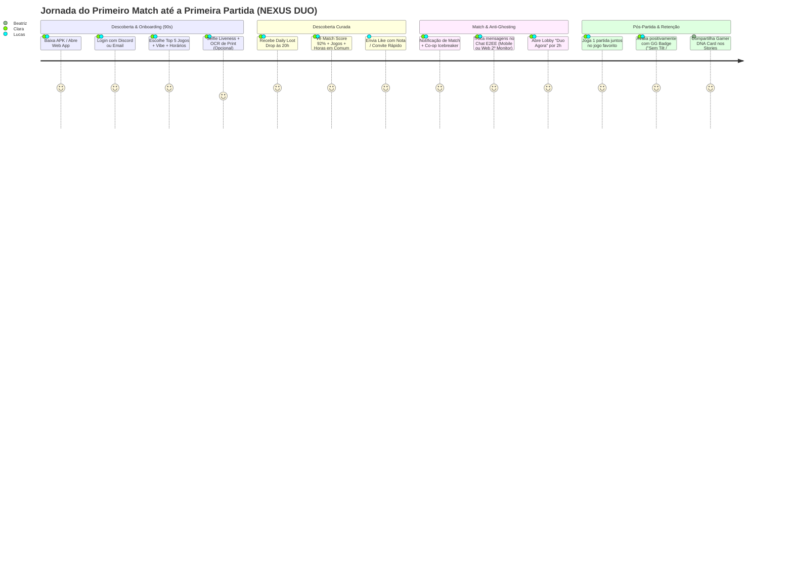

# 👥 02 — Personas, Mapas de Empatia e Jornadas do Usuário

Para criar um produto real com alta retenção e equilíbrio saudável de gênero e perfis, o **NEXUS DUO** foi modelado sobre 4 personas primárias baseadas no ecossistema gamer brasileiro e global.

---

## 🎭 Persona 1 — Clara ("Valkyrie"), 24 anos — *A Gamer que Busca Segurança e Conexão Real*

- **Perfil:** Designer gráfica, São Paulo (SP). Joga *Valorant* (Platina), *Baldur's Gate 3* e *Stardew Valley*. Joga das 20h às 23h30 durante a semana.
- **Objetivo:** Encontrar um parceiro maduro, engraçado, que não dê rage em partida e que também curta sair no fim de semana.
- **Frustrações:** Em jogos competitivos sofre machismo ao abrir o microfone; no Tinder recebe cantadas genéricas e caras que acham estranho ela montar o próprio PC.

### Mapa de Empatia — Clara
| Dimensão | Insights |
|---|---|
| **Pensa e Sente** | *"Quero alguém com quem eu possa jogar de madrugada e também tomar um café no domingo — sem ter que provar que sei jogar."* |
| **Vê** | Amigas desistindo de apps de relacionamento por falta de filtro e excesso de caras tóxicos; perfis fakes sem verificação. |
| **Escuta** | Comentários sexistas em voz aberta no competitivo; amigas elogiando quando conhecem alguém jogando em grupo fechado. |
| **Fala e Faz** | Usa filtros rigorosos; só passa Discord depois de confiar; valoriza muito selos de verificação e reputação. |
| **Dores** | Assédio, toxicidade, fakes, conversa monossilábica. |
| **Ganhos** | Controle de quem pode iniciar conversa, selo *Player Verificado*, *GG Badges* ("Calmo / Sem Tilt"), *Co-op First Date* seguro. |

---

## 🎭 Persona 2 — Lucas ("Kael_BR"), 26 anos — *O Competitivo de Alma Tranquila*

- **Perfil:** Desenvolvedor back-end, Curitiba (PR). Joga *League of Legends*, *CS2* e *Elden Ring*. Usa PC com **dois monitores** o dia inteiro.
- **Objetivo:** Conhecer uma namorada que entenda sua rotina, curta maratonar séries/animes ou puxar um duo sem pressão.
- **Frustrações:** Dá centenas de swipes em apps tradicionais com taxa de match baixíssima; não sabe puxar assunto sem parecer forçado.

### Mapa de Empatia — Lucas
| Dimensão | Insights |
|---|---|
| **Pensa e Sente** | *"Na conversa por texto eu travo, mas jogando uma partida em call eu sou super natural e divertido."* |
| **Vê** | Amigos gastando dinheiro em Tinder Platinum sem resultado real; filas de 5 minutos entre partidas onde fica olhando o segundo monitor. |
| **Escuta** | "Você precisa tirar fotos viajando de lancha pra ter match." |
| **Fala e Faz** | Deixa o navegador aberto no 2º monitor; compartilha memes de jogos; orgulha-se da sua biblioteca Steam. |
| **Dores** | Fadiga de swipe, sensação de invisibilidade no algoritmo (efeito Pareto), dificuldade de quebrar o gelo. |
| **Ganhos** | Algoritmo justo que valoriza afinidade real de jogos/horários; Web App no 2º monitor; *Co-op Icebreaker* pronto no chat. |

---

## 🎭 Persona 3 — Beatriz ("BiaCozy"), 21 anos — *A Gamer Casual, Cozy & Story-Driven*

- **Perfil:** Estudante de psicologia, Belo Horizonte (MG). Joga *The Sims 4*, *Animal Crossing*, *Genshin Impact*, *Minecraft* e *It Takes Two* (Mobile + Switch + Notebook).
- **Objetivo:** Encontrar alguém carinhoso, criativo e que não ache que "só jogo de tiro é jogo de verdade".
- **Frustrações:** Sente-se excluída por comunidades gamers elitistas ("gatekeeping"); busca estética bonita e acolhedora.

### Mapa de Empatia — Beatriz
| Dimensão | Insights |
|---|---|
| **Pensa e Sente** | *"Não jogo ranked, mas amo construir mundos juntos e zerar jogos cooperativos com história."* |
| **Vê** | Apps gamers cheios de neon verde agressivo com cara de fórum antigo. |
| **Escuta** | "Jogar no celular ou Stardew não conta como gamer." |
| **Fala e Faz** | Adora personalizar perfil, compartilhar cards estéticos no Instagram Stories e jogar no celular antes de dormir. |
| **Dores** | Gatekeeping gamer, UI feia/masculinizada demais, falta de filtros de "Vibe" (Cozy / História / Co-op). |
| **Ganhos** | Estética elegante *Cyber-Velvet*, tag de vibe "Cozy & Co-op", *Gamer DNA Card* lindo para compartilhar, matches por estilo emocional. |

---

## 🎭 Persona 4 — Rafael ("RafaTank"), 31 anos — *O Gamer Adulto com Tempo Curto*

- **Perfil:** Engenheiro de produção, Porto Alegre (RS). Joga *Diablo IV*, *EA FC*, *Helldivers 2* no PS5 e PC. Só tem tempo livre terças/quintas das 21h às 23h e sábados.
- **Objetivo:** Relacionamento sério com alguém que tenha rotina compatível — sem perder tempo com quem só joga de madrugada ou mora longe demais.
- **Frustrações:** Dá match com pessoas cujos horários nunca batem; odeia apps lentos ou que pedem cadastro burocrático de 20 telas.

### Mapa de Empatia — Rafael
| Dimensão | Insights |
|---|---|
| **Pensa e Sente** | *"Meu tempo é curto. Quero qualidade de matches, não 500 perfis aleatórios."* |
| **Vê** | Apps que escondem quem curtiu atrás de planos caríssimos; falta de transparência na compatibilidade. |
| **Escuta** | Amigos dizendo que conhecer alguém compatível depois dos 30 está cada vez mais difícil. |
| **Fala e Faz** | Prefere onboarding rápido; valoriza privacidade de localização e dados; gosta de ver compatibilidade clara logo no card. |
| **Dores** | Horários incompatíveis, perda de tempo, falta de transparência. |
| **Ganhos** | Badge de compatibilidade de agenda ("Vocês têm 6h livres em comum esta semana"), *Daily Loot Drop* curado de alta precisão, cadastro em < 90 segundos. |

---

## 🗺️ Jornada Crítica do Usuário (Golden Path — MVP)

