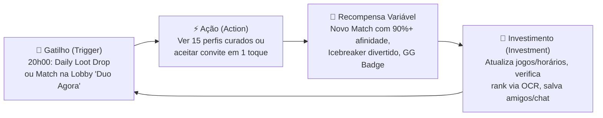

# 🧠 03 — Psicologia Comportamental, Atração e Retenção Ética

Aplicativos de relacionamento falham por dois extremos: ou são **viciantes e tóxicos** (dopamina vazia de swipe infinito que gera exaustão emocional e abandono em 14 dias), ou são **frios e sem tração** (usuário entra, não sente progresso e desinstala no D1).

O **NEXUS DUO** aplica psicologia científica baseada em **Teoria da Autodeterminação (SDT)**, **Modelo Hooked (Nir Eyal) ético**, **Economia Comportamental** e **Psicologia de Segurança Social** para maximizar retenção sustentável e conexões reais.

---

## 1. Fundamentos Psicológicos Aplicados ao Produto

### 1.1 Teoria da Autodeterminação (Self-Determination Theory — Deci & Ryan)
Usuários retornam espontaneamente quando 3 necessidades psicológicas inatas são atendidas:
1. **Autonomia:** O usuário controla sua visibilidade, quem pode iniciar o chat, seu modo atual (*Só Relacionamento*, *Duo + Relacionamento*, *Pausado*) e seus horários.
2. **Competência (Maestria):** O usuário vê sua identidade gamer valorizada (OCR de rank, biblioteca de jogos, badges conquistadas por bom comportamento, percentual claro de compatibilidade).
3. **Pertencimento (Relatedness):** A sensação imediata de "esta comunidade fala a minha língua" — reduzindo a ansiedade social do primeiro contato por meio de jogos em comum.

### 1.2 O "Co-op First Date" — Redução Drástica de Ansiedade Social
Na psicologia relacional, encontros face-a-face ou conversas em texto sem contexto geram **alta carga cognitiva e medo de rejeição**.
- **Solução NEXUS DUO:** Atividade compartilhada de foco paralelo (*Side-by-Side Bonding*). Quando duas pessoas jogam uma partida cooperativa ou casual juntas, o foco está na tela — o silêncio não é constrangedor, o humor surge naturalmente e a compatibilidade de temperamento (como a pessoa reage sob pressão/derrota) aparece em 20 minutos!

### 1.3 Anti-Swipe Fatigue & Escassez Saudável (Paradoxo da Escolha — Barry Schwartz)
Swipe infinito causa *Decision Fatigue* e desvalorização humana (as pessoas viram cartas descartáveis).
- **Mecânica:** **Daily Loot Drop** — 15 a 20 perfis de altíssima afinidade liberados diariamente às **20h00** (horário de pico gamer), com um contador visual elegante.
- **Efeito psicológico:** Cria antecipação positiva (ritual diário), aumenta a atenção dedicada a cada perfil (+3x taxa de leitura de bio) e eleva drasticamente a taxa de reciprocidade real.

### 1.4 Anti-Ghosting & Efeito Zeigarnik
O cérebro humano tende a concluir interações que já começaram com um micro-compromisso (*Efeito Zeigarnik*).
- **Co-op Icebreaker Automático:** Ao dar Match, a tela de chat **nunca abre em branco**. O sistema exibe 3 gatilhos personalizados baseados nos dados em comum:
  - *Convite direto:* "Vocês dois jogam Valorant e estão livres hoje às 21h. Topam um Swiftplay?"
  - *Pergunta divertida (2 escolhas):* "No Stardew Valley: fazenda perfeitamente organizada ou caos criativo?"
  - *Mini-quiz de 30s:* "Qual personagem/mapa vocês baniriam para sempre?"
- **Lembrete gentil de 24h:** Se o match não teve primeira mensagem em 24h, um empurrão leve (*nudge*) sugere enviar um convite rápido de 1 toque.

### 1.5 Reputação Positiva ("GG / Fair Play Badges") — Psicologia de Reforço Positivo
Sistemas de "nota de 1 a 5 estrelas" para humanos geram ansiedade e abuso (*efeito Black Mirror*).
- **Solução Ética:** Apenas **sinais positivos voluntários** após interação/partida:
  - 🎧 *Boa Comunicação*
  - 🧘 *Zero Tilt / Calmo(a)*
  - 🛡️ *Parceiro(a) de Squad*
  - ✨ *Papo Incrível*
  - 🏆 *Respeitoso(a)*
- **Impacto comportamental:** Condicionamento positivo — usuários naturalmente se comportam melhor para colecionar selos visíveis no seu Gamer Card, reduzindo toxicidade sem precisar de moderação humana cara!

### 1.6 Segurança Psicológica & Proteção contra Assédio (Foco em Equilíbrio de Gênero)
Em apps de relacionamento, o sucesso da liquidez depende de **mulheres e minorias se sentirem 100% seguras e respeitadas**:
- **Selo Player Verificado** gratuito via *Selfie Liveness* on-device (filtro de busca: "Mostrar apenas perfis verificados").
- **Escudo Anti-Toxicidade:** Detecção local/edge de palavras ofensivas/assédio explícito com aviso imediato + bloqueio em 1 toque que apaga o histórico e impede novo pareamento.
- **Modo "Elas/Eles Primeiro" opcional:** Qualquer usuário pode ativar a opção de apenas quem recebeu o match enviar a primeira mensagem ou exigir resposta ao *Co-op Icebreaker* antes de liberar envio de imagens.
- **Blur Protetor de Mídia:** Qualquer foto enviada no chat chega borrada por padrão e só revela se o destinatário tocar em "Visualizar".

---

## 2. Ciclo de Retenção Ética (Hook Model — NEXUS DUO)

---

## 3. Métricas Psicológicas & North Star (Analytics Privacy-First)

| Métrica | Fórmula / Definição | Meta MVP |
|---|---|---|
| **North Star — Meaningful Duo Rate (MDR)** | % de Matches que trocam $\ge 10$ mensagens ou iniciam 1 Lobby "Duo Agora" em até 48h | $\ge 38\%$ |
| **Time to First Meaningful Message** | Mediana de tempo entre o Match e a 1ª mensagem real | $< 15\text{ min}$ |
| **Retenção D1 / D7 / D30** | % de usuários ativos após 1, 7 e 30 dias | D1 $\ge 50\%$ / D7 $\ge 28\%$ / D30 $\ge 15\%$ |
| **Taxa de Verificação Liveness** | % de contas ativas que completam o selo *Player Verificado* | $\ge 65\%$ |
| **Índice de Segurança** | Taxa de denúncias por 1.000 matches (quanto menor, melhor) | $< 2{,}0$ |
| **K-Factor Orgânico** | Novos cadastros originados de compartilhamento do *Gamer DNA Card* | $\ge 0{,}35$ |
