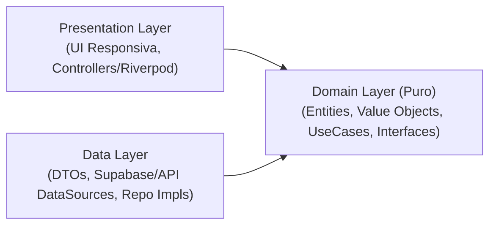
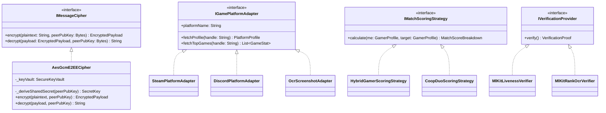

# 🏛️ 05 — Arquitetura de Software, Monorepo e OOP Sênior

## 1. ADR-001 — Decisão Arquitetural: Mobile (Flutter) + Web (Next.js) Caminhando Juntos

### Contexto
O projeto exige aplicativo **Mobile em Flutter** e versão **Web**, caminhando juntos em paridade funcional, escalabilidade, custo zero de infraestrutura no MVP e padrão de mercado.

### Alternativas Avaliadas
| Critério | Opção A: Apenas Flutter Web | Opção B: Monorepo Híbrido (Flutter Mobile + Next.js Web + Supabase Único) |
|---|---|---|
| **SEO & Aquisição Orgânica (CAC = R\$ 0)** | Fraco (Canvas/Wasm, sem SSR real, Open Graph limitado) | **Excelente** (SSR/ISR nativo, `og:image` dinâmico de Gamer Card, LCP < 0.8s) |
| **Performance no 2º Monitor do Gamer (PC)** | Alto consumo de RAM/GPU competindo com jogos abertos! | **Ultra-leve** (DOM nativo, baixíssimo uso de GPU/RAM junto com jogos AAA) |
| **Experiência Mobile Nativa (60/120fps, ML Kit, Keystore)** | Excelente | **Excelente** (Flutter 3.47+ nativo) |
| **Paridade de Regras & Dados** | Código único | **Backend-Driven Single Source of Truth** (100% regras críticas em PostgreSQL/RPC/Edge + Design Tokens compartilhados) |
| **Custo de Hospedagem** | Grátis | **Grátis** (Cloudflare Pages / Vercel Hobby + Supabase Free) |

### Decisão Final (Aprovada)
Adotar o **Monorepo Híbrido Unificado**:
- `apps/mobile`: **Flutter 3.47+ / Dart 3.13+** (Android/iOS, ML Kit on-device, Keystore/Keychain, Auto-Update GitHub Releases + Shorebird OTA).
- `apps/web`: **Next.js (App Router) + React + TypeScript Strict + Tailwind CSS** (Landing SEO, Gamer Card público compartilhável `/u/@nick`, Web App completa otimizada para **2º Monitor** em tempo real).
- `supabase/`: **Single Source of Truth** (Migrations SQL versionadas, Políticas RLS, RPCs PostgreSQL, Edge Functions Deno, testes `pgTAP`).
- `packages/design-tokens`: Fonte única de cores, espaçamentos, raios e tipografia em JSON, compilada via script para `apps/mobile` (Dart) e `apps/web` (CSS/Tailwind).
- `packages/contracts`: Contratos OpenAPI/TypeScript/Dart gerados diretamente do schema Supabase (`supabase gen types`) garantindo zero desalinhamento entre Mobile, Web e Banco!

---

## 2. Estrutura Completa do Monorepo

```text
nexus-duo/
├── .github/
│   └── workflows/
│       ├── ci-quality.yml          # Lint, Analyze, Unit, Golden, RLS, Playwright
│       ├── release-android.yml     # Build APK assinado + SHA-256 + GitHub Release
│       ├── patch-shorebird.yml     # OTA Dart patches sem novo APK
│       ├── deploy-web.yml          # Deploy automático Web (Vercel/Cloudflare)
│       └── keepalive-staging.yml   # Evita pausa por inatividade no Free Tier
├── .vscode/
│   ├── extensions.json
│   ├── settings.json
│   └── launch.json
├── apps/
│   ├── mobile/                     # Flutter 3.47+ (Clean Architecture + Feature-First)
│   │   ├── lib/
│   │   │   ├── core/
│   │   │   │   ├── config/         # Env, Feature Flags
│   │   │   │   ├── crypto/         # E2EE X25519 + AES-256-GCM (Encapsulado)
│   │   │   │   ├── errors/         # Failures & Exceptions tipadas
│   │   │   │   ├── network/        # SupabaseClient + Dio interceptors
│   │   │   │   ├── router/         # GoRouter + Auth/Onboarding Guards
│   │   │   │   ├── theme/          # Tokens gerados + Cyber-Velvet Theme
│   │   │   │   ├── updater/        # GitHub Releases SHA-256 + Shorebird OTA
│   │   │   │   └── widgets/        # Design System Components responsivos
│   │   │   └── features/
│   │   │       ├── auth/           # domain/ data/ presentation/
│   │   │       ├── onboarding/     # domain/ data/ presentation/
│   │   │       ├── discovery/      # Deck, Match Score, DP Schedule, Swipes
│   │   │       ├── verification/   # ML Kit Selfie Liveness + Rank OCR
│   │   │       ├── lobby/          # Lobby Efêmero "Duo Agora"
│   │   │       ├── chat/           # Realtime Chat E2EE + Co-op Icebreakers
│   │   │       ├── profile/        # Gamer DNA Card + GG Badges + LGPD
│   │   │       └── integrations/   # Adapters polimórficos (Steam/Discord/IGDB)
│   │   └── test/                   # unit/ widget/ golden/ integration/
│   └── web/                        # Next.js App Router + TypeScript + Tailwind
│       ├── src/
│       │   ├── app/                # (marketing)/ (app)/ u/[username]/ api/
│       │   ├── core/               # crypto (WebCrypto E2EE), supabase, design
│       │   ├── features/           # discovery/ lobby/ chat/ profile/ auth/
│       │   └── components/         # UI Kit alinhado 1:1 com Flutter
│       └── tests/                  # unit/ (Vitest) + e2e/ (Playwright)
├── packages/
│   ├── design-tokens/              # tokens.json + build-tokens.mjs (Dart + CSS)
│   └── contracts/                  # Tipos gerados do Supabase + DTO schemas
├── supabase/
│   ├── config.toml
│   ├── migrations/                 # DDL, Índices, RLS, RPCs, Triggers
│   ├── functions/                  # Edge Functions (game-search, sync-steam, etc.)
│   ├── seed.sql                    # Dados seed realistas para dev/QA
│   └── tests/                      # Testes de segurança RLS em pgTAP
└── docs/                           # Toda a documentação sênior (00 a 11 + Prompt)
```

---

## 3. Clean Architecture + Feature-First (Mobile & Web)

Cada feature é autocontida em 3 camadas concêntricas com **Inversão de Dependência (DIP)**:



- **Regra de Ouro:** A camada `Domain` contém **apenas Dart/TypeScript puro**, zero imports de Flutter, Next.js ou Supabase. Isso garante 100% de testabilidade em milissegundos e independência de framework!

---

## 4. Orientação a Objetos (OOP) & SOLID Aplicados na Prática

O código não usa OOP de forma decorativa — cada pilar resolve um problema arquitetural real:



### Aplicação Rigorosa dos 4 Pilares de OOP:
1. **Encapsulamento:**
   - Value Objects imutáveis que validam invariantes no construtor privado/factory (ex.: `GamerAge` impede cadastro `< 18 anos`; `WeeklyScheduleMask` encapsula a matriz `7x24` em 3 inteiros de 64 bits impedindo estados inválidos; `SecureKeyVault` nunca expõe bytes crus da chave privada fora da classe de criptografia).
2. **Abstração:**
   - Interfaces coesas (`IMatchRepository`, `IMessageCipher`, `IGamePlatformAdapter`, `IVerificationProvider`) isolam detalhes voláteis (ex.: trocar RAWG por IGDB ou trocar storage local não afeta nenhuma regra de domínio).
3. **Polimorfismo:**
   - `IMatchScoringStrategy`: permite alternar em runtime o algoritmo de pontuação entre modo *"Relacionamento Híbrido"* e modo *"Lobby Duo Agora"* sem nenhum `if/else` espalhado pela UI.
   - `IGamePlatformAdapter`: uma única rotina `SyncUserGamesUseCase` orquestra polimorficamente Steam, Discord, OpenDota e OCR de print.
4. **Herança Controlada & Composição Preferencial:**
   - Hierarquia rasa apenas para classes seladas (`sealed class AppFailure` -> `NetworkFailure`, `CryptoFailure`, `AuthFailure`, `RlsPermissionFailure`) aproveitando *pattern matching* exaustivo do Dart 3.13!
   - Composição para combinar comportamentos (ex.: `CachedGameCatalogRepository` decorando `SupabaseGameCatalogRepository` — *Decorator Pattern*).
