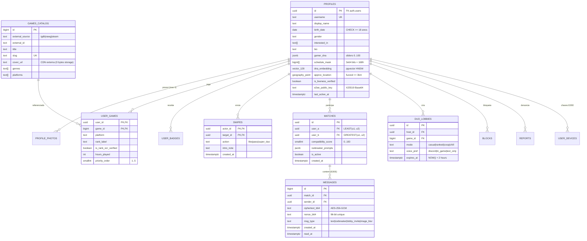

# 🗄️🔐 06 — Banco de Dados Supabase (DBA Sênior), Zero-Trust RLS & Criptografia

Este documento especifica a fundação de dados e segurança cibernética do **NEXUS DUO** no **Supabase (PostgreSQL 15+)**, projetada para:
1. Rodar com folga no **Supabase Free Tier** (500 MB DB, 1 GB Storage, 50.000 MAU, 200 Realtime concurrent).
2. Garantir **Zero-Trust Security** com Row Level Security (RLS) auditável e testável.
3. Proteger privacidade física (geolocalização) e digital (chat E2EE + LGPD).

---

## 1. Diagrama Entidade-Relacionamento (DER)



---

## 2. Schema SQL Base & Índices de Alta Performance

### 2.1 Extensões Obrigatórias no Supabase
```sql
CREATE EXTENSION IF NOT EXISTS "pgcrypto";
CREATE EXTENSION IF NOT EXISTS "postgis";
CREATE EXTENSION IF NOT EXISTS "vector";
CREATE EXTENSION IF NOT EXISTS "pg_trgm"; -- Busca fuzzy ultrarrápida de jogos
```

### 2.2 Otimizações de DBA para Escala e Free Tier (500 MB)
1. **Vetores Compactos (`vector(128)` + HNSW):** Em vez de vetores de 1536/3072 dimensões que devoram RAM e disco, nosso *Gamer DNA Embedding* determinístico + aprendido tem **128 dimensões `halfvec`/`vector(128)`**, ocupando apenas **~512 bytes por usuário** (100.000 usuários = ~50 MB!).
2. **Agenda Semanal Comprimida em Bitmask (`bigint[3]`):** 168 horas da semana cabem em 3 inteiros de 64 bits (24 bytes por perfil!) permitindo cálculo de interseção de horários por operação bit-a-bit (`&`) em microssegundos!
3. **Unicidade Canônica de Matches:** `user_a = LEAST(actor, target)` e `user_b = GREATEST(actor, target)` com `UNIQUE (user_a, user_b)` — impossibilita matematicamente matches duplicados em condição de corrida (*race condition*)!
4. **Índices Estratégicos:**
   - `CREATE INDEX idx_profiles_location ON profiles USING GIST (approx_location);` — busca radial em $O(\log N)$.
   - `CREATE INDEX idx_profiles_dna_hnsw ON profiles USING hnsw (dna_embedding vector_cosine_ops);` — busca semântica aproximada em $O(\log N)$.
   - `CREATE INDEX idx_games_title_trgm ON games_catalog USING GIN (title gin_trgm_ops);` — autocomplete de jogos em `< 5 ms`.
   - `CREATE INDEX idx_messages_match_created ON messages (match_id, created_at DESC);` — paginação cursor-based $O(\log N)$ sem `OFFSET` lento.
   - `CREATE INDEX idx_lobbies_active ON duo_lobbies (expires_at) WHERE expires_at > now();` — índice parcial enxuto.

---

## 3. Segurança Zero-Trust (Row Level Security — RLS)

**Regra Absoluta:** `ALTER TABLE <tabela> ENABLE ROW LEVEL SECURITY;` em **100% das tabelas**.

### 3.1 Exemplos de Políticas RLS Inegociáveis
```sql
-- 1. PROFILES: Usuário só edita o próprio perfil; nunca lê perfis que o bloquearam
CREATE POLICY "profiles_select_visible" ON public.profiles
FOR SELECT TO authenticated
USING (
  id = auth.uid()
  OR (
    is_active = true
    AND NOT EXISTS (
      SELECT 1 FROM public.blocks b
      WHERE (b.blocker_id = auth.uid() AND b.blocked_id = profiles.id)
         OR (b.blocker_id = profiles.id AND b.blocked_id = auth.uid())
    )
  )
);

CREATE POLICY "profiles_update_own" ON public.profiles
FOR UPDATE TO authenticated
USING (id = auth.uid())
WITH CHECK (id = auth.uid());

-- 2. SWIPES: Apenas o próprio autor pode inserir/ver seus swipes (evita espiar likes sem permissão)
CREATE POLICY "swipes_insert_own" ON public.swipes
FOR INSERT TO authenticated
WITH CHECK (actor_id = auth.uid() AND target_id <> auth.uid());

CREATE POLICY "swipes_select_own" ON public.swipes
FOR SELECT TO authenticated
USING (actor_id = auth.uid());

-- 3. MATCHES: Somente os dois participantes enxergam o match
CREATE POLICY "matches_select_participants" ON public.matches
FOR SELECT TO authenticated
USING (auth.uid() IN (user_a, user_b));

-- 4. MESSAGES (E2EE): Apenas participantes de um match ATIVO e sem bloqueio leem/enviam
CREATE POLICY "messages_select_participants" ON public.messages
FOR SELECT TO authenticated
USING (
  EXISTS (
    SELECT 1 FROM public.matches m
    WHERE m.id = messages.match_id
      AND m.is_active = true
      AND auth.uid() IN (m.user_a, m.user_b)
  )
);

CREATE POLICY "messages_insert_sender" ON public.messages
FOR INSERT TO authenticated
WITH CHECK (
  sender_id = auth.uid()
  AND EXISTS (
    SELECT 1 FROM public.matches m
    WHERE m.id = messages.match_id
      AND m.is_active = true
      AND auth.uid() IN (m.user_a, m.user_b)
  )
);
```

### 3.2 Privacidade de Localização (Anti-Trilateração & Anti-Stalking)
- A coluna `approx_location` **nunca** é retornada em `SELECT` para outros usuários (usamos uma `VIEW` ou RPC `get_discovery_deck` com `SECURITY DEFINER SET search_path = public`).
- Ao atualizar localização, o banco aplica **Location Fuzzing determinístico por célula H3/grid (~3 a 5 km)** + jitter aleatório.
- A API retorna apenas `distance_km_bucket` (ex.: `"< 5 km"`, `"~12 km"`, `"~25 km"`) — impedindo matematicamente ataques de trilateração!

---

## 4. Protocolo Criptográfico E2EE (Cross-Platform Mobile <-> Web)

Para garantir que **nem mesmo o banco de dados ou administradores** possam ler mensagens privadas, implementamos E2EE compatível entre **Dart (`package:cryptography`)** e **Web (`SubtleCrypto` / `libsodium`)**:

1. **Geração de Par de Chaves no Onboarding:**
   - Algoritmo: **X25519 (Curve25519 ECDH)**.
   - Chave pública (`32 bytes`, Base64) salva em `profiles.e2ee_public_key`.
   - Chave privada armazenada exclusivamente em:
     - **Mobile:** `flutter_secure_storage` (Android Keystore Hardware-backed / iOS Keychain `kSecAttrAccessibleAfterFirstUnlockThisDeviceOnly`).
     - **Web:** `IndexedDB` armazenando objeto `CryptoKey` com `extractable: false` (imune a leitura direta de bytes via XSS simples).
2. **Derivação da Chave de Conversa (por Match):**
   - `shared_secret = X25519(my_private_key, peer_public_key)`
   - `session_key = HKDF-SHA256(ikm: shared_secret, salt: match_id_bytes, info: "nexus-duo-e2ee-v1", length: 32)`
3. **Cifragem de Cada Mensagem:**
   - Algoritmo: **AES-256-GCM** (cifragem autenticada AEAD — protege confidencialidade e integridade contra adulteração).
   - Nonce: **96 bits (12 bytes)** gerados via CSPRNG a cada mensagem (`nonce_b64` salvo junto ao `ciphertext_b64`).
   - AAD (*Additional Authenticated Data*): `match_id || sender_id` — impede ataque de redirecionamento de mensagem para outro chat!
4. **Recuperação Multi-Dispositivo Opcional (Mobile <-> Web 2º Monitor):**
   - O usuário pode configurar um **PIN/Frase de Cofre** (derivada com **Argon2id** no cliente) para salvar um backup cifrado da sua chave privada em `user_key_backups` — assim, ao abrir o Web App no 2º monitor, digita sua frase de cofre e lê seu chat E2EE perfeitamente sincronizado!

---

## 5. Blindagem Cibernética (OWASP Mobile & Web Top 10)

| Vetor de Ataque | Mitigação Arquitetural no NEXUS DUO |
|---|---|
| **IDOR / Broken Object Level Auth** | RLS rigorosa com `auth.uid()` + testes automatizados `pgTAP` para cada tabela |
| **SQL Injection / Search Path Hijack** | Queries 100% parametrizadas + RPCs com `SET search_path = public, pg_temp` |
| **Brute Force / Scraping / Swipe Bot** | Rate Limiting em Edge Functions + gatilho SQL limitando swipes por janela + Daily Loot Drop |
| **XSS / CSRF (Web Next.js)** | Content-Security-Policy (CSP) estrita, Cookies `HttpOnly`/`Secure`/`SameSite=Lax` via `@supabase/ssr`, sanitização de markdown/bio |
| **Man-in-the-Middle (MITM)** | HTTPS TLS 1.3 obrigatório + HSTS + E2EE no chat + verificação `SHA-256` em downloads de APK |
| **Vazamento de Metadados EXIF em Fotos** | Re-encodificação client-side para WebP antes do upload (remove automaticamente GPS, câmera e data do arquivo original!) |
| **LGPD — Exclusão Completa** | RPC `delete_my_account()` remove perfil (`ON DELETE CASCADE`), revoga sessões e dispara Edge Function para purgar fotos no Storage |
