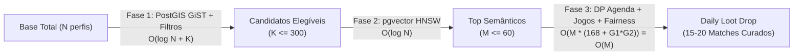

# 🤖📐 07 — IA, Machine Learning, Visão Computacional, OCR & Algoritmos de Match

Este documento projeta o coração algorítmico do **NEXUS DUO**, unindo **Complexidade de Algoritmos**, **Programação Dinâmica**, **Busca Vetorial (`pgvector`)** e **Visão Computacional / OCR 100% On-Device (Custo Zero)**.

---

## 1. Arquitetura do Motor de Match Híbrido (3 Fases)

Um erro comum em apps de relacionamento é rodar scoring complexo sobre toda a base $O(N^2)$ — o que colapsa o banco com poucos milhares de usuários. No **NEXUS DUO**, projetamos um funil em **3 estágios de complexidade sublinear**:

### Fase 1 — Pré-Filtro Espacial e de Preferências (PostgreSQL + PostGIS)
- Filtra: faixa etária mútua, gênero/interesse mútuo, raio de distância (`ST_DWithin` com índice GiST), exclui já vistos (`swipes`) e bloqueados (`blocks`), e opcionalmente `is_liveness_verified = true`.
- **Complexidade:** $O(\log N + K)$, com limite rígido $K \le 300$ candidatos ativos recentemente.

### Fase 2 — Similaridade de Gamer DNA via Embeddings (`pgvector` HNSW)
Cada usuário possui um vetor normalizado $\mathbf{v} \in \mathbb{R}^{128}$ composto de forma transparente e determinística (sem precisar pagar API da OpenAI!):
- Dimensões `0..31`: Distribuição ponderada de gêneros de jogos (FPS, MOBA, RPG, Cozy, Soulslike, Indie, Strategy, Fighting, etc.).
- Dimensões `32..63`: Vetor de plataformas, estilo de comunicação (voz/texto), perfil competitivo vs. casual, objetivo de relacionamento.
- Dimensões `64..127`: Projeção de hash semântico (*Feature Hashing / MinHash*) dos jogos favoritos e tags de personalidade/interesses extras (anime, música, filmes, pets).

A similaridade de cosseno é calculada no PostgreSQL:
$$S_{\text{dna}}(u, v) = \frac{1 + \cos(\mathbf{v}_u, \mathbf{v}_v)}{2} \in [0, 1]$$
- **Complexidade com índice HNSW:** $O(\log N)$ em média para recuperar o Top $M = 60$.

### Fase 3 — Programação Dinâmica (DP) para Compatibilidade de Agenda & Jogos

#### 3.1 DP de Janelas Contínuas de Jogo (*Continuous Co-op Window DP*)
Duas pessoas terem 15 minutos livres espalhados em dias diferentes não permite jogar uma partida de 1h30 juntos!
- Representação: `overlap[0..167]` obtido por operação bit-a-bit `mask_u & mask_v` (3 instruções de CPU!).
- **Recorrência de Programação Dinâmica:**
  Seja $dp[t]$ o tamanho do bloco contínuo de horas livres em comum que termina na hora $t \in [0, 167]$ (com *wrap-around* domingo-noite $\to$ segunda-madrugada):
  $$dp[t] = \begin{cases} dp[t-1] + 1 & \text{se } \text{overlap}[t] = 1 \\ 0 & \text{se } \text{overlap}[t] = 0 \end{cases}$$
- Pontuamos blocos contínuos com recompensa não-linear (janelas $\ge 2\text{h}$ valem muito mais que blocos isolados de 1h):
  $$S_{\text{agenda}}(u, v) = \min\!\left(1,\; \frac{\sum_{\text{bloco } b \ge 2} w(b)}{10}\right)$$
- **Complexidade:** Tempo $O(168) = O(1)$ por candidato; Espaço $O(1)$ usando apenas 2 variáveis escalares!

#### 3.2 Afinidade Ponderada de Jogos Favoritos (Weighted Priority Matching + DP)
Sejam $G_u$ e $G_v$ as listas ordenadas de até $P \le 10$ jogos favoritos (peso $w_i = 1 / \log_2(i + 2)$ — *Discounted Cumulative Gain*, onde o jogo #1 pesa muito mais que o jogo #10):
- Calculamos:
  1. **Interseção Ponderada de Jogos Exatos** ($S_{\text{exact}}$) com bônus se ambos possuem o mesmo modo (Co-op / Ranked / Casual) e plataforma compatível (ou jogo com *crossplay*).
  2. **Alinhamento de Prioridade / Subsequência Comum Ponderada (Weighted LCS DP)** sobre gêneros principais em $O(|G_u| \cdot |G_v|) \le O(100) = O(1)$ com memoização.

#### 3.3 Score Final Multi-Objetivo & Anti-Concentração (Fairness)
$$S_{\text{total}}(u, v) = 0{,}35\,S_{\text{jogos}} + 0{,}25\,S_{\text{agenda}} + 0{,}25\,S_{\text{dna}} + 0{,}15\,S_{\text{proximidade}}$$

Para evitar o **efeito Pareto destrutivo** (onde 5% dos perfis monopolizam todos os likes e 80% se sentem invisíveis), aplicamos um fator de justiça inspirado em **Gale-Shapley / Exposure Fairness**:
$$\text{RankScore}(u, v) = S_{\text{total}}(u, v) \cdot \underbrace{\left(1 + \alpha \cdot \text{ReciprocityProb}(v \to u)\right)}_{\text{Probabilidade mútua}} \cdot \underbrace{\frac{1}{1 + \beta \cdot \text{DailyImpressions}(v)}}_{\text{Decay de superexposição}} \cdot \underbrace{B_{\text{newbie/verified}}}_{\text{Boost inicial ético}}$$

### Tabela Resumo de Complexidade (Por Requisição do Deck)
| Etapa | Tempo | Espaço | Latência Alvo |
|---|---|---|---|
| Pré-filtro PostGIS + Exclusões | $O(\log N + K)$ | $O(K)$ | $< 12\text{ ms}$ |
| Similaridade `pgvector` HNSW | $O(\log N)$ | $O(M)$ | $< 8\text{ ms}$ |
| DP Agenda + Jogos + Fairness ($M \le 60$) | $O(M)$ | $O(M)$ | $< 3\text{ ms}$ |
| **Total do Funil Completo** | **$O(\log N + K)$** | **$O(K)$** | **$< 25\text{ ms}$** |

---

## 2. Visão Computacional & OCR 100% On-Device (Custo Zero)

Nenhuma imagem biométrica ou print precisa pagar API de nuvem (AWS Rekognition / Google Cloud Vision). Todo o pipeline de CV/OCR roda localmente no hardware do usuário!

### 2.1 Selfie Liveness Anti-Catfish (Mobile: `google_mlkit_face_detection` | Web: MediaPipe Face Landmarker WASM)
Máquina de estados determinística de 3 desafios aleatórios (impede foto impressa ou print estático):
1. **Enquadramento:** Detecta exatamente **1 rosto**, centralizado, boa luminosidade, `trackingId` contínuo (sem cortes de vídeo).
2. **Desafio 1 (Aleatório):** *"Pisque os dois olhos"* (`leftEyeOpenProbability < 0.25 && rightEyeOpenProbability < 0.25` seguido de `> 0.75`).
3. **Desafio 2 (Aleatório):** *"Vire levemente o rosto para a esquerda/direita"* (`headEulerAngleY < -18°` ou `> +18°`).
4. **Desafio 3 (Aleatório):** *"Dê um sorriso natural"* (`smilingProbability > 0.72`).
5. **Saída Segura:** Captura 1 frame frontal nítido, compara hash estrutural / embedding facial local contra a foto principal do perfil (opcional na V1.5 com MobileFaceNet TFLite), envia prova assinada de conclusão ao Supabase e ativa `is_liveness_verified = true`.
- **Otimização de Bateria:** Throttling da câmera em **8–10 FPS** durante o check; liberação imediata do `FaceDetector` ao finalizar.

### 2.2 Verificação de Rank & Gamertag via OCR (`google_mlkit_text_recognition` | Web: `Tesseract.js`)
Uma das inovações mais amadas por gamers, com **custo R\$ 0**:
1. O usuário seleciona um print da sua tela de perfil no **Valorant, League of Legends, CS2, Overwatch 2, Rocket League, Genshin Impact, PlayStation ou Xbox**.
2. O OCR on-device extrai blocos de texto (`RecognizedText`) e coordenadas espaciais.
3. Um parser polimórfico (`IRankOcrParser` -> `ValorantOcrParser`, `LolOcrParser`, `Cs2OcrParser`, `GenericGamerOcrParser`) aplica expressões regulares validadas para identificar:
   - **Jogo detectado**
   - **Nick / Riot ID / Gamertag** (ex.: `Valkyrie#BR1`)
   - **Rank / Elo / Nível** (ex.: `Platina II`, `Diamante`, `AR 58`, `18.450 Premier`)
4. O usuário confirma os dados extraídos em 1 toque e ganha o selo visual **`Rank Verificado via Print`** no seu Gamer Card — sem precisar expor senha da sua conta de jogo!

---

## 3. Evolução de Machine Learning (Pós-MVP, Baixo Custo)
Quando o app atingir 10.000+ interações de match:
- **Two-Tower Lightweight Model (Treino offline semanal gratuito no GitHub Actions / Colab):** Refina os pesos das 128 dimensões do `dna_embedding` com base em *Meaningful Duos* reais (conversas longas + lobbies concluídos), e não apenas likes superficiais!
- **Moderação Textual On-Device (TensorFlow Lite / ONNX Quantizado < 4 MB):** Classifica toxicidade e assédio em português brasileiro antes do envio, protegendo a comunidade a custo zero de GPU em nuvem.
