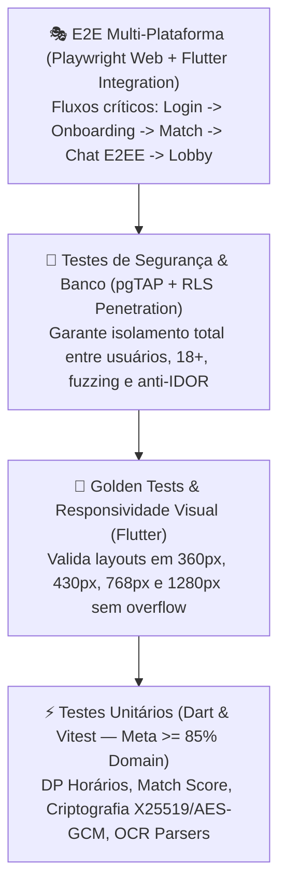
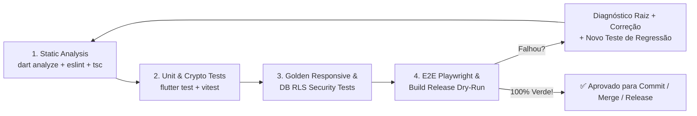

# 🧪🚀 10 — Qualidade de Software, Ciclos Profundos de Testes & DevOps CI/CD

Para que o **NEXUS DUO** tenha padrão real de mercado e se atualize de forma autônoma nos celulares dos usuários sem quebrar produção, estabelecemos uma engenharia implacável de **Qualidade (QA)** e **Entrega Contínua (CI/CD)**.

---

## 1. Pirâmide de Testes Automatizados (Cobertura Profunda)

### Detalhamento por Camada
1. **Testes Unitários (Rápidos — `< 5s`):**
   - **Algoritmos & DP:** Testes de borda para `WeeklyScheduleMask` (*wrap-around* domingo 23h $\to$ segunda 01h, agenda vazia, agenda cheia, blocos de 1h vs $\ge 2\text{h}$), `MatchScoringStrategy` e *fairness decay*.
   - **Criptografia Cross-Platform (Golden Vectors):** Vetores de teste compartilhados garantindo que uma mensagem cifrada pelo **Dart (`AesGcmE2EECipher`)** é decifrada com 100% de fidelidade pelo **TypeScript (`WebCryptoCipher`)** e vice-versa!
   - **OCR Parsers:** Testes com amostras reais de texto ruidoso de prints de Valorant, LoL, CS2, Genshin e PlayStation.
2. **Widget Tests + Golden Tests de Responsividade (Flutter):**
   - Cada tela principal é renderizada automaticamente em **4 tamanhos de viewport** (`360x800`, `412x915`, `768x1024`, `1280x800`) e com `textScaleFactor = 1.3`, falhando o build imediatamente se houver qualquer `RenderFlex overflow`!
3. **Testes de Banco & Segurança RLS (`pgTAP`):**
   - Simula JWTs distintos (`user_a`, `user_b`, `user_c_blocked`, `anon`) validando que:
     - `anon` não lê perfis privados, swipes nem mensagens.
     - `user_c_blocked` não enxerga `user_a` em buscas nem consegue inserir mensagem.
     - `user_a` não consegue forjar `sender_id = user_b` nem inserir swipe para si mesmo.
4. **Testes E2E Web (`Playwright`):**
   - Testa Landing Page (SEO meta tags + LCP), fluxo de autenticação, Deck de Descoberta, responsividade desktop 3 colunas e troca de mensagens E2EE entre dois contextos de navegador simultâneos!

---

## 2. Protocolo de Ciclo Profundo de Self-Healing QA (Autônomo)

Sempre que uma feature ou sprint for implementada, o agente deve executar o **Loop Fechado de Correção Automatizada** até atingir **ZERO falhas**:

---

## 3. Pipeline CI/CD no GitHub Actions (`WagnerxOliveira/nexus-duo`)

### 3.1 `ci-quality.yml` (Roda em todo Push & Pull Request)
- **Job 1 (`tokens`):** Verifica se `packages/design-tokens` está sincronizado com Mobile e Web.
- **Job 2 (`mobile-qa`):** `flutter pub get` -> `dart format --set-exit-if-changed` -> `dart analyze --fatal-infos` -> `flutter test --coverage`.
- **Job 3 (`web-qa`):** `npm ci` -> `npm run lint` -> `npm run typecheck` -> `npm run test` -> `npm run build` -> `npx playwright test`.
- **Job 4 (`db-security`):** Validação de sintaxe SQL + execução dos testes RLS `pgTAP` em Supabase local/container.

### 3.2 `auto-release-mobile.yml` & `release-android.yml` (Commit -> Push -> Release Automática)
Todo `push` na branch `main` alterando `apps/mobile/**`, `packages/**` ou scripts de release dispara automaticamente:
1. **Quality Gate (`auto-release-mobile.yml`):** valida testes dos scripts, auditoria SQL Zero-Trust, `dart format`, `flutter analyze` e `flutter test` antes de gerar versão (ignorando commits com `[skip release]` / `[skip ci]`).
2. **Auto-Bump (`scripts/bump-mobile-version.mjs`):** analisa os *Conventional Commits* desde a última tag (`feat!:` -> major, `feat:` -> minor, `fix:`/`perf:` -> patch), incrementa `versionName` + `versionCode` de forma estritamente monotônica em `apps/mobile/pubspec.yaml` e cria a tag semântica `vX.Y.Z`.
3. **Build Assinado Obrigatório (`release-android.yml`):** falha em *fail-fast* se o keystore PKCS12 (`ANDROID_KEYSTORE_BASE64`) estiver ausente, extrai o SHA-256 do certificado de assinatura X.509, compila APKs `--split-per-abi` (`arm64-v8a`, `armeabi-v7a`, `x86_64`) + `universal`, gera `SHA256SUMS.txt` e o manifesto canônico `update-manifest.json` (schema v2) e publica todos os ativos na **GitHub Release**.

### 3.3 Estratégia Dual-Track: APK Self-Update vs. `patch-shorebird.yml` (OTA)
- **Trilha Principal Soberana (100% Gratuita — APK Self-Update In-App):** padrão para **qualquer alteração** (Dart, Kotlin, AndroidManifest, ML Kit, ícones, assets ou plugins). Entrega APK assinado com o mesmo certificado via CDN direta do GitHub, sem limites de cota.
- **Trilha Opcional Instantânea (`patch-shorebird.yml`):** reservada para hotfixes **exclusivamente em código Dart** (sem alterar dependências nativas), acionada manualmente quando `SHOREBIRD_TOKEN` estiver configurado (Free Tier: até **5.000 patches/mês**).

### 3.4 `deploy-web.yml` (Deploy Web Contínuo)
- Merge na `main` dispara deploy automático da pasta `apps/web` na **Cloudflare Pages** ou **Vercel** com preview URLs por Pull Request.

---

## 4. Arquitetura de Auto-Update Discreto In-App no Celular Android

Para que **todo usuário com o APK instalado receba atualizações com 1 toque sem abrir navegador ou GitHub**:

1. **Manifesto CDN Zero-Rate-Limit (`update-manifest.json`) + Edge Function (`app-update-manifest`):**
   - O app consulta primeiro `https://github.com/WagnerxOliveira/nexus-duo/releases/latest/download/update-manifest.json` (download direto via CDN com suporte a `ETag` — **imune ao limite de 60 req/h por IP da API REST do GitHub em CGNAT móvel**).
   - Fallback cacheado e controle remoto via Supabase Edge Function `app-update-manifest` (`Cache-Control: public, max-age=120`) combinada com a tabela RLS `app_release_channels` (*kill-switch* de rollout e `force_update` para correções críticas).
2. **Ciclo de Vida Automático (`AppLifecycleState.resumed`):**
   - Ao voltar dos Ajustes do Android após liberar *"Instalar apps desconhecidos"*, o app detecta a permissão e **abre o instalador nativo automaticamente sem cliques extras**.
   - Re-checa silenciosamente o manifesto se o app ficou em segundo plano por `>= 15 min` e limpa APKs antigos do cache (`cleanupStaleApks`).
3. **Integridade Criptográfica Multicamada + UX Discreta *Cyber-Velvet*:**
   - Allowlist estrita de URLs HTTPS (`github.com` / `githubusercontent.com`), checagem prévia de espaço livre (`StatFs`), streaming `.part` com retomada `HTTP 206 Range` e backoff, verificação incremental `SHA-256` e validação nativa em `MainActivity.kt` (`packageName`, `versionCode` estritamente maior e fingerprint do certificado de assinatura).
   - **Zero poluição visual quando atualizado:** a pílula discreta **`Atualizar`** aparece suavemente apenas quando há nova versão (com opção **"Lembrar depois"** por 24h e **"Minimizar"** download em andamento).
