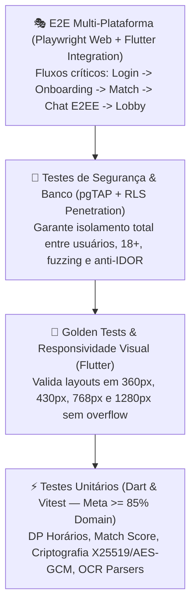
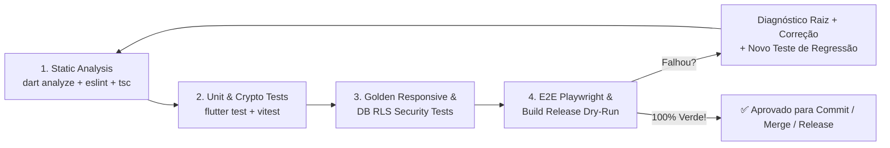

# 🧪🚀 10 — Qualidade de Software, Ciclos Profundos de Testes & DevOps CI/CD

Para que o **NEXUS DUO** tenha padrão real de mercado e se atualize de forma autônoma nos celulares dos usuários sem quebrar produção, estabelecemos uma engenharia implacável de **Qualidade (QA)** e **Entrega Contínua (CI/CD)**.

---

## 1. Pirâmide de Testes Automatizados (Cobertura Profunda)

### Detalhamento por Camada
1. **Testes Unitários (Rápidos — `< 5s`):**
   - **Algoritmos & DP:** Testes de borda para `WeeklyScheduleMask` (*wrap-around* domingo 23h $\to$ segunda 01h, agenda vazia, agenda cheia, blocos de 1h vs $\ge 2\text{h}$), `MatchScoringStrategy` e *fairness decay*.
   - **Criptografia Cross-Platform (Golden Vectors):** Vetores de teste compartilhados garantindo que uma mensagem cifrada pelo **Dart (`AesGcmE2EECipher`)** é decifrada com 100% de fidelidade pelo **TypeScript (`WebCryptoCipher`)** e vice-versa!
   - **OCR Parsers:** Testes com amostras reais de texto ruidoso de prints de Valorant, LoL, CS2, Genshin e PlayStation.
2. **Widget Tests + Golden Tests de Responsividade (Flutter):**
   - Cada tela principal é renderizada automaticamente em **4 tamanhos de viewport** (`360x800`, `412x915`, `768x1024`, `1280x800`) e com `textScaleFactor = 1.3`, falhando o build imediatamente se houver qualquer `RenderFlex overflow`!
3. **Testes de Banco & Segurança RLS (`pgTAP`):**
   - Simula JWTs distintos (`user_a`, `user_b`, `user_c_blocked`, `anon`) validando que:
     - `anon` não lê perfis privados, swipes nem mensagens.
     - `user_c_blocked` não enxerga `user_a` em buscas nem consegue inserir mensagem.
     - `user_a` não consegue forjar `sender_id = user_b` nem inserir swipe para si mesmo.
4. **Testes E2E Web (`Playwright`):**
   - Testa Landing Page (SEO meta tags + LCP), fluxo de autenticação, Deck de Descoberta, responsividade desktop 3 colunas e troca de mensagens E2EE entre dois contextos de navegador simultâneos!

---

## 2. Protocolo de Ciclo Profundo de Self-Healing QA (Autônomo)

Sempre que uma feature ou sprint for implementada, o agente deve executar o **Loop Fechado de Correção Automatizada** até atingir **ZERO falhas**:

---

## 3. Pipeline CI/CD no GitHub Actions (`WagnerxOliveira/nexus-duo`)

### 3.1 `ci-quality.yml` (Roda em todo Push & Pull Request)
- **Job 1 (`tokens`):** Verifica se `packages/design-tokens` está sincronizado com Mobile e Web.
- **Job 2 (`mobile-qa`):** `flutter pub get` -> `dart format --set-exit-if-changed` -> `dart analyze --fatal-infos` -> `flutter test --coverage`.
- **Job 3 (`web-qa`):** `npm ci` -> `npm run lint` -> `npm run typecheck` -> `npm run test` -> `npm run build` -> `npx playwright test`.
- **Job 4 (`db-security`):** Validação de sintaxe SQL + execução dos testes RLS `pgTAP` em Supabase local/container.

### 3.2 `release-android.yml` (Build Automático de APK + GitHub Release)
Disparado automaticamente ao criar uma tag semântica (`git tag v1.0.0 && git push --tags`) ou via `workflow_dispatch`:
1. Configura Java 17 + Flutter `3.47.5` (estável).
2. Injeta `android/key.properties` e keystore a partir dos **GitHub Secrets** (`ANDROID_KEYSTORE_BASE64`, `ANDROID_KEY_PASSWORD`, `ANDROID_STORE_PASSWORD`, `ANDROID_KEY_ALIAS`) — nunca no código!
3. Compila `flutter build apk --release --split-per-abi` (APKs leves por arquitetura `arm64-v8a` e `armeabi-v7a` + APK universal) — ou `shorebird release android` quando Shorebird estiver vinculado.
4. Gera arquivo `SHA256SUMS.txt` com os hashes criptográficos de cada APK.
5. Publica automaticamente a **GitHub Release** com changelog gerado pelos Conventional Commits, anexando os APKs e `SHA256SUMS.txt`.

### 3.3 `patch-shorebird.yml` (Atualização OTA Instantânea para Mudanças em Dart)
Quando há ajustes de UI, correções de bugs ou melhorias puramente em Dart (sem mudar dependências nativas Android):
- Executa `shorebird patch android` (Free Tier: até **5.000 instalações de patch/mês** grátis).
- Os celulares dos usuários baixam o diff binário silenciosamente e aplicam na próxima abertura do app!

### 3.4 `deploy-web.yml` (Deploy Web Contínuo)
- Merge na `main` dispara deploy automático da pasta `apps/web` na **Cloudflare Pages** ou **Vercel** com preview URLs por Pull Request.

---

## 4. Arquitetura de Auto-Update Autônomo no Celular Android

Para que **todo usuário com o APK instalado se atualize de forma autônoma** sempre que você fizer merge/release no GitHub:

1. **Camada 1 — Patch Silencioso (Mudanças Dart):** **Shorebird OTA** atualiza o código Dart em segundos em segundo plano sem pedir reinstalação do APK.
2. **Camada 2 — Atualização de Binário Base (Mudanças Nativas/Novas Versões):**
   - Serviço `GitHubReleaseUpdater` no Flutter consulta (no máximo 1x a cada 6h, respeitando cache ETag para não bater rate limit da API pública do GitHub):
     `GET https://api.github.com/repos/WagnerxOliveira/nexus-duo/releases/latest`
   - Compara `tag_name` (`SemVer`) com `PackageInfo.fromPlatform().version`.
   - Se houver versão mais nova, exibe um modal elegante *Cyber-Velvet* com as novidades da versão (*Release Notes*) e botão **"Atualizar Agora"**.
   - Faz o download com barra de progresso, **verifica o hash `SHA-256` contra `SHA256SUMS.txt` da mesma release** (bloqueando qualquer APK corrompido ou adulterado!) e aciona o instalador nativo Android via `FileProvider` (`REQUEST_INSTALL_PACKAGES`).
