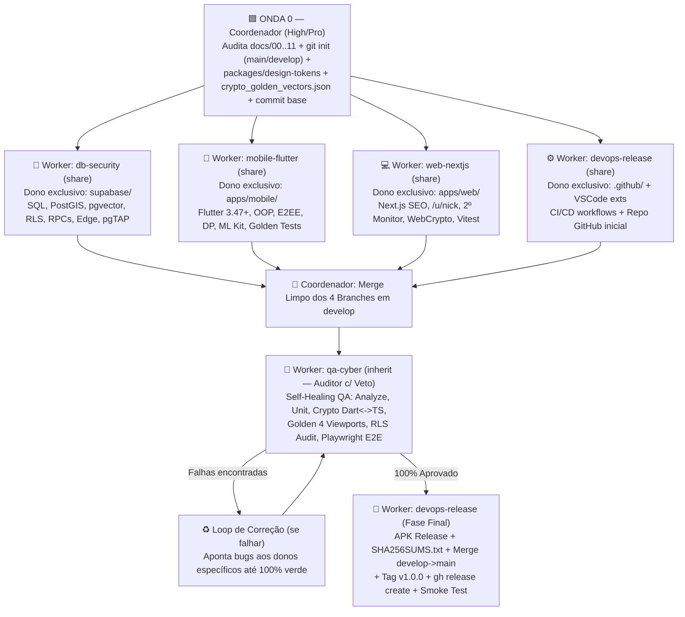

# 🚀 Prompt Mestre de Execução Multi-Agente (`/teamwork`) — NEXUS DUO

Este documento contém a **análise aprofundada de orquestração multi-agente no Antigravity** e o **Prompt Definitivo pronto para copiar e colar** começando com `/teamwork`, projetado para executar o MVP completo do **NEXUS DUO** com máxima qualidade, zero conflitos de merge, interoperabilidade criptográfica garantida e ciclo fechado de Self-Healing QA.

---

## 1. Análise Aprofundada da Orquestração `/teamwork` (Engenharia de Enxame)

Por que um enxame mal estruturado falha, e como este prompt elimina 100% desses riscos:

| Risco Clássico em Multi-Agentes | Solução Arquitetural Aplicada Neste Prompt |
|---|---|
| **Conflitos de Merge entre agentes** | **Fronteiras de Posse Disjuntas (*Strict Ownership*)** + execução em **4 Ondas (DAG)**: nenhum par de workers edita a mesma pasta (`supabase/`, `apps/mobile/`, `apps/web/`, `.github/`). |
| **Desalinhamento Visual Mobile vs. Web** | **Onda 0 no Coordenador** gera `packages/design-tokens/tokens.json` + gerador Dart/CSS antes de disparar os workers com `workspace: "share"`. |
| **Falha de Interoperabilidade E2EE (Dart $\leftrightarrow$ WebCrypto)** | Contrato binário exato definido no prompt (`X25519` + `HKDF-SHA256` + `AES-256-GCM` concatenando `ciphertext || tag16`, `AAD = match_id:sender_id`) + arquivo compartilhado `packages/contracts/crypto_golden_vectors.json` validado pelos dois lados! |
| **Bloqueio se credenciais Supabase ainda não foram coladas** | Injeção de dependência polimórfica: implementação real `Supabase*Repository` 100% pronta + fallback automático `DemoSeed*Repository` quando `.env` não estiver preenchido — permitindo testar UI, E2E e APK imediatamente sem crash. |
| **Testes superficiais ("parece que compila")** | Agente **`qa-cyber`** dedicado e independente com poder de veto (*Zero Rubber-Stamp*), executando `dart analyze --fatal-infos`, Golden Tests em 4 viewports, `pgTAP`/RLS audit, Vitest e Playwright E2E em loop de *Self-Healing* até 100% verde. |
| **Desperdício de cota / Modelo inadequado** | Coordenador em modelo **High/Pro** + workers críticos (`db-security`, `mobile-flutter`, `web-nextjs`, `qa-cyber`) em **High/Pro** + `devops-release` em modelo **Flash/padrão** (verificado via `swarm(action: "models")`). |

---

## 2. Grafo de Execução em 4 Ondas (DAG do Enxame)



---

## 3. PROMPT DEFINITIVO PARA COPIAR E COLAR (`/teamwork`)

> **Instrução de uso:** Copie **todo** o conteúdo dentro do bloco abaixo (já começa com `/teamwork`) e cole diretamente aqui no chat do Antigravity.

````markdown
/teamwork Você é o **Coordenador (Principal Architect & Staff Engineering Manager)** do enxame responsável por implementar o MVP de produção do **NEXUS DUO** (*aplicativo de relacionamento gamer Mobile em Flutter + Web 2º Monitor em Next.js + Backend Zero-Trust no Supabase*), localizado no workspace `c:\00_projeto_gamer_match` (Windows 11 — Flutter 3.47.5 / Dart 3.13.4 / Node 24.19.0 / Git 2.54.0 / GitHub CLI `gh` / VS Code já instalados).

====================================================================
0. LEITURA OBRIGATÓRIA & CONTRATO INEGOCIÁVEL
====================================================================
Antes de criar qualquer worker ou escrever código, leia TODOS os documentos em `c:\00_projeto_gamer_match\docs\` (`00_INDICE_MESTRE.md` até `11_AMBIENTE_VSCODE_E_INSTALACAO.md`), além de `README.md`, `CONTRIBUTING.md`, `SECURITY.md` e `.vscode/`.
Todas as decisões de estética (*Cyber-Velvet & Obsidian Neon*), psicologia, arquitetura OOP, banco Supabase Zero-Trust, criptografia E2EE, algoritmos DP, ML Kit/OCR, backlog MVP e CI/CD devem obedecer 100% ao especificado nesses documentos.

====================================================================
1. REGRAS GLOBAIS DE AUTONOMIA, AMBIENTE & QUALIDADE
====================================================================
- **Autonomia Total:** Não me peça para rodar comandos no PowerShell. Execute tudo autonomamente (`code --install-extension`, `flutter`, `dart`, `npm`, `git`, `gh`, testes e builds). Só me interrompa se precisar de credencial privada minha (ex.: `SUPABASE_URL`/`SUPABASE_ANON_KEY`) ou aprovação de rede externa na 1ª execução.
- **Zero Segredos no Git:** Jamais versione `.env`, `.env.local`, `*.jks`, `*.keystore`, `key.properties` ou tokens. Crie `.env.example` completos.
- **Modo Real + Resiliência Demo/Offline:** Tanto Mobile quanto Web devem possuir implementação real 100% funcional para Supabase via variáveis de ambiente **E** um fallback polimórfico limpo (`DemoSeedRepository`) ativado automaticamente quando `SUPABASE_URL` não estiver configurada, garantindo que o app abra, navegue, rode todos os testes, Playwright E2E e demonstração visual sem crashar!
- **Contrato Binário Exato de Criptografia E2EE (Cross-Platform Dart <-> TypeScript):**
  - Troca de chaves: **X25519** (chave pública raw 32 bytes em Base64).
  - Derivação: **HKDF-SHA256** com `ikm = shared_secret(32B)`, `salt = UTF8(match_id)`, `info = UTF8("nexus-duo-e2ee-v1")`, `length = 32 bytes`.
  - Cifragem: **AES-256-GCM** com `nonce = 12 bytes` (CSPRNG), `aad = UTF8(match_id + ":" + sender_id)`, `tagLength = 128 bits (16 bytes)`.
  - Serialização obrigatória no banco (`messages.ciphertext_b64`): **`Base64(cipherTextBytes || authTag16Bytes)`** (atenção especial no Dart `package:cryptography`, que separa `secretBox.cipherText` e `secretBox.mac.bytes` — concatenar na cifragem e fatiar os últimos 16 bytes na decifragem para 100% de compatibilidade com `WebCrypto SubtleCrypto`!).
- **Seleção de Modelos do Enxame:** Consulte `swarm(action: "models")` antes de criar os workers. Use seu modelo **High/Pro** (ou o modelo padrão do coordenador) para `db-security`, `mobile-flutter`, `web-nextjs` e `qa-cyber`; use modelo mais rápido (**Flash** ou equivalente disponível) para `devops-release`.

====================================================================
2. EXECUÇÃO EM 4 ONDAS SINCRONIZADAS (ZERO CONFLITOS DE MERGE)
====================================================================

### 🟦 ONDA 0 — FUNDAÇÃO NO COORDENADOR (Execute ANTES de criar os workers)
1. Defina o título do swarm: `"NEXUS DUO — MVP Mobile + Web + Supabase"`.
2. Inicialize o repositório Git local em `c:\00_projeto_gamer_match` com branch `main` (commit inicial da documentação) e crie a branch de integração `develop` a partir dela.
3. Crie `packages/design-tokens/tokens.json` (paleta *Cyber-Velvet & Obsidian Neon*, escala tipográfica `1.200`, espaçamentos 4/8px, raios, sombras, breakpoints) + script `packages/design-tokens/build-tokens.mjs` que gera automaticamente:
   - `packages/design-tokens/dist/nexus_tokens.dart`
   - `packages/design-tokens/dist/tokens.css`
   Rode `node packages/design-tokens/build-tokens.mjs` e valide a saída.
4. Crie `packages/contracts/crypto_golden_vectors.json` contendo 3 vetores determinísticos reais de teste (pares X25519 fixos, `match_id`, `sender_id`, `nonce_b64`, `plaintext`, `expected_ciphertext_b64`) gerados via script Node `crypto` e validados, para que `mobile-flutter` e `web-nextjs` provem matematicamente a interoperabilidade E2EE nos seus testes unitários!
5. Faça commit limpo na `develop` (`chore(core): bootstrap monorepo tokens and e2ee golden vectors`).

---

### 🟩 ONDA 1 — CONSTRUÇÃO PARALELA (Spawne 4 Workers em `workspace: "share"` com Fronteiras Disjuntas)

Envie briefs claros, autossuficientes e completos para cada um dos 4 especialistas abaixo (lembre: cada worker começa do zero e só vê o repositório + seu brief):

#### 1) Worker `db-security` (`workspace: "share"`, modelo High/Pro)
- **Posse Exclusiva:** `supabase/` (não tocar em `apps/` nem `.github/`).
- **Missão Completa:**
  - Ler `docs/06_BANCO_DE_DADOS_SUPABASE_E_SEGURANCA.md`, `docs/07_IA_ML_OCR_E_ALGORITMOS_MATCH.md` e `docs/08_INOVACOES_CUSTO_ZERO_E_APIS.md`.
  - Criar `supabase/config.toml` e migrations numeradas em `supabase/migrations/`:
    - `0001_extensions_and_types.sql`: `pgcrypto`, `postgis`, `vector`, `pg_trgm`, enums.
    - `0002_core_tables_and_indexes.sql`: `profiles` (com `CHECK (birth_date <= CURRENT_DATE - INTERVAL '18 years')`, `schedule_mask bigint[3]`, `dna_embedding vector(128)`, `approx_location geography(Point, 4326)`, `e2ee_public_key`), `profile_photos` (max 4), `games_catalog`, `user_games`, `user_badges`, `swipes`, `matches` (unicidade canônica `LEAST`/`GREATEST`), `messages` (E2EE `ciphertext_b64` + `nonce_b64`), `duo_lobbies` (expiração 2h), `blocks`, `reports`, `user_key_backups`, + todos os índices GiST, HNSW, GIN trigram, compostos e parciais.
    - `0003_zero_trust_rls.sql`: `ENABLE ROW LEVEL SECURITY` em 100% das tabelas + políticas restritivas de `SELECT/INSERT/UPDATE/DELETE` (bloqueando bloqueados, terceiros, auto-swipe, forjamento de `sender_id` e acesso anônimo indevido).
    - `0004_rpcs_and_triggers.sql`: `update_fuzzed_location()` (fuzzing >= 3km), `get_discovery_deck()` (PostGIS + `pgvector` HNSW + bucket de distância sem expor lat/lng), `record_swipe_and_match()` (criação atômica de match + geração de 3 Co-op Icebreakers), `delete_my_account()` (LGPD), `export_my_data()` (LGPD), todas com `SECURITY DEFINER SET search_path = public, pg_temp`.
  - Criar `supabase/seed.sql` com catálogo inicial de 30+ jogos populares (Valorant, LoL, CS2, Stardew Valley, Genshin, Minecraft, BG3, Elden Ring, Fortnite, Rocket League, EA FC, It Takes Two, Helldivers 2, etc.) usando capas CDN oficiais.
  - Criar Edge Functions em `supabase/functions/`: `game-search/` (cache no `games_catalog` + IGDB/RAWG fallback) e `health/`.
  - Criar suíte completa de testes de segurança RLS em `supabase/tests/rls_security.test.sql` (`pgTAP`) validando isolamento entre `user_a`, `user_b`, `blocked_user` e `anon`.
  - Validar toda a sintaxe SQL e reportar ao coordenador quando pronto.

#### 2) Worker `mobile-flutter` (`workspace: "share"`, modelo High/Pro)
- **Posse Exclusiva:** `apps/mobile/` (não tocar em `supabase/`, `apps/web/` nem `.github/`).
- **Missão Completa:**
  - Ler `docs/03`, `04`, `05`, `06`, `07`, `08`, `09`, `10` e importar os tokens de `packages/design-tokens/dist/nexus_tokens.dart` e vetores de `packages/contracts/crypto_golden_vectors.json`.
  - Criar app Flutter 3.47+ em `apps/mobile` (`com.nexusduo.app`, Clean Architecture + Feature-First + Riverpod + GoRouter + `supabase_flutter` + `cryptography` + `flutter_secure_storage` + `google_mlkit_face_detection` + `google_mlkit_text_recognition` + `package_info_plus` + `dio` + `cached_network_image`).
  - **OOP Real Obrigatório:**
    - Value Objects imutáveis validados: `GamerAge` (>= 18), `WeeklyScheduleMask` (`bigint[3]`, operações bit-a-bit + **DP de Janelas Contínuas de Jogo** com wrap-around $O(168)$), `MatchScoreBreakdown`.
    - Interfaces polimórficas: `IMessageCipher` (`AesGcmE2EECipher` seguindo o contrato binário exato!), `IMatchScoringStrategy` (`HybridGamerScoringStrategy` e `CoopDuoScoringStrategy` + Fairness Decay), `IGamePlatformAdapter` (`SteamPlatformAdapter`, `DiscordPlatformAdapter`, `OcrScreenshotAdapter`), `IVerificationProvider` (`MlKitLivenessVerifier`, `MlKitRankOcrVerifier`), `IRankOcrParser` (`ValorantOcrParser`, `LolOcrParser`, `Cs2OcrParser`, `GenericGamerOcrParser`), `sealed class AppFailure`.
  - **Telas de Alto Padrão *Cyber-Velvet & Obsidian Neon* (Zero Overflow):**
    1. Splash & Welcome cinematográfico (Discord + Email + Modo Demo instantâneo).
    2. Onboarding 4 passos (< 90s): Identidade 18+, Top 5 Jogos, Sliders Gamer DNA + Grade de Horários Semanais, Fotos (compressão WebP) + Verificação Liveness & OCR de Rank.
    3. Descoberta — Deck *Daily Loot Drop* (scrim obrigatório sobre foto, anel Match Score %, jogos em comum, badge `Xh livres em comum`, scroll vertical para detalhes/DNA/GG Badges, ações na Thumb Zone).
    4. Celebração de Match (*"IT'S A DUO!"*) com 3 *Co-op Icebreakers* clicáveis.
    5. Lobby Efêmero *"Duo Agora"* (2h) com filtro por jogo/modo e contador regressivo.
    6. Chat E2EE em Tempo Real com cadeado verificado, bolhas AAA, blur protetor em mídia, atalho Discord/Gamertag e envio de *GG Badges*.
    7. Perfil & *Gamer DNA Shareable Card* (`9:16` exportável) + Central de Privacidade LGPD + **Auto-Updater In-App (`GitHubReleaseUpdater`)** consultando `WagnerxOliveira/nexus-duo/releases/latest` com validação `SHA-256` (+ arquivo `shorebird.yaml` pronto).
  - **Testes Obrigatórios (Rodar antes de entregar!):**
    - Unit tests: DP de Horários (incluindo wrap-around), `MatchScoringStrategy`, OCR Parsers e **Golden Vectors E2EE** (lendo `crypto_golden_vectors.json` e provando 100% de match com WebCrypto!).
    - Widget & Responsive Golden Tests validando renderização **sem overflow** em `360x800`, `412x915`, `768x1024`, `1280x800` e `textScaleFactor: 1.3`.
    - `dart format --output=none --set-exit-if-changed .`, `dart analyze --fatal-infos` e `flutter test` **100% verdes**.

#### 3) Worker `web-nextjs` (`workspace: "share"`, modelo High/Pro)
- **Posse Exclusiva:** `apps/web/` (não tocar em `supabase/`, `apps/mobile/` nem `.github/`).
- **Missão Completa:**
  - Ler `docs/04`, `05`, `06`, `07`, `08`, `09`, `10` e consumir `packages/design-tokens/dist/tokens.css` e `packages/contracts/crypto_golden_vectors.json`.
  - Criar aplicação **Next.js (App Router) + React + TypeScript Strict + Tailwind CSS + Vitest + Playwright** em `apps/web`:
    1. **Landing Page Cinematográfica (SEO 100/100):** Hero *Cyber-Velvet*, proposta de valor, preview interativo do Match Card e Lobby "Duo Agora", seção de segurança E2EE/Liveness, botão de download direto da última Release Android no GitHub e entrada imediata no Web App.
    2. **Página Pública Viral `/u/[username]`:** Gamer DNA Card público estilizado + metadata Open Graph dinâmica para compartilhamento no Discord/Instagram/X.
    3. **Web App "Modo 2º Monitor" (`/app`):** Layout responsivo adaptativo (**3 colunas no Desktop**: Rail `80px` + Matches/Lobby `320px` + Palco Principal Deck/Chat E2EE; **1 coluna + Bottom Nav no Mobile Web**), otimizada para baixo consumo de CPU/GPU enquanto o usuário joga no 1º monitor!
    4. **Criptografia E2EE WebCrypto (`src/core/crypto/webCryptoCipher.ts`):** Implementação usando `SubtleCrypto` (`X25519` / fallback `@noble/curves` + `HKDF-SHA256` + `AES-256-GCM`) validada contra o MESMO `crypto_golden_vectors.json` do Flutter!
    5. **Mesmo Motor DP de Horários & Scoring** em TypeScript puro (`src/core/algo/scheduleDp.ts`) + Chat Realtime + Lobby "Duo Agora" + Privacidade/LGPD + Fallback polimórfico Demo quando `.env.local` não tiver Supabase configurado.
  - **Testes Obrigatórios (Rodar antes de entregar!):**
    - Vitest: DP de horários, Match Score e **Golden Vectors E2EE** (100% compatível com o Dart!).
    - Playwright E2E: Landing SEO, `/u/[username]`, fluxo de Onboarding/Descoberta, troca de mensagem E2EE no chat e verificação responsiva Desktop (`1440x900`) + Mobile (`390x844`).
    - `npm run lint`, `npm run typecheck`, `npm test`, `npm run build` **100% verdes**.

#### 4) Worker `devops-release` (`workspace: "share"`, modelo Flash/padrão)
- **Posse Exclusiva:** `.github/`, scripts de automação em `scripts/`, instalação de extensões VSCode e gestão remota do GitHub (não tocar no código-fonte interno de `apps/` nem `supabase/`).
- **Missão Fase 1 (Paralela):**
  - Instalar todas as extensões listadas em `.vscode/extensions.json` via `code --install-extension`.
  - Criar `.vscode/launch.json` pronto para debugar Flutter Mobile e Next.js Web.
  - Criar workflows profissionais em `.github/workflows/`:
    - `ci-quality.yml` (Tokens + Flutter analyze/test + Next.js lint/typecheck/vitest/build/playwright + validação SQL)
    - `release-android.yml` (Build APK release + `SHA256SUMS.txt` + publicação automática de GitHub Release)
    - `patch-shorebird.yml` (OTA patches Dart via `workflow_dispatch`)
    - `deploy-web.yml` (Build & deploy Web)
    - `keepalive-staging.yml` (Cron a cada 4 dias evitando pausa do Supabase Free Tier)
  - Verificar `gh auth status` e preparar/criar o repositório remoto `WagnerxOliveira/nexus-duo` (se ainda não existir) sem sobrescrever código dos outros workers.

---

### 🟨 ONDA 2 — INTEGRAÇÃO & AUDITORIA IMPLACÁVEL (Coordenador + Worker `qa-cyber`)
1. Quando `db-security`, `mobile-flutter`, `web-nextjs` e `devops-release` concluírem a Onda 1, o **Coordenador** faz merge limpo dos 4 branches na branch `develop` (resolvendo qualquer ajuste de integração de tokens/contratos).
2. O Coordenador spawna o 5º especialista **`qa-cyber`** (`workspace: "inherit"`, modelo High/Pro) com **poder absoluto de veto**:
   - **Auditoria 1 — Interoperabilidade Criptográfica Real:** Executa teste cruzado garantindo que uma mensagem cifrada pelo Dart é decifrada pelo TypeScript e vice-versa.
   - **Auditoria 2 — Segurança & RLS:** Revisa cada arquivo em `supabase/migrations/` confirmando RLS ativo em 100% das tabelas, `SET search_path` em todas as RPCs `SECURITY DEFINER`, `Location Fuzzing`, remoção de EXIF, `CHECK >= 18 anos` e ausência total de segredos ou `service_role` no código cliente.
   - **Auditoria 3 — Qualidade Mobile & Responsividade:** Roda `dart analyze --fatal-infos`, `flutter test` (incluindo Golden Tests de 4 viewports + escala de fonte `1.3`).
   - **Auditoria 4 — Qualidade Web & E2E:** Roda `npm run lint`, `npm run typecheck`, `npm test`, `npm run build` e `npx playwright test` verificando console sem erros e layout sem overflow.
   - **Protocolo de Self-Healing QA:** Se qualquer item falhar, `@qa-cyber` lista os problemas exatos com arquivo/linha e aciona `@db-security`, `@mobile-flutter` ou `@web-nextjs` para corrigir e adicionar teste de regressão, repetindo até **100% VERDE**.

---

### 🚀 ONDA 3 — BUILD FINAL, MERGE & GITHUB RELEASE AUTÔNOMA (`devops-release` + Coordenador)
Somente após o **APROVADO FORMAL** de `@qa-cyber`:
1. `@devops-release` compila o APK Android de produção (`cd apps/mobile && flutter build apk --release`), calcula `SHA256SUMS.txt` e valida o binário gerado.
2. Verifica que `git status` está limpo, faz commits finais em Conventional Commits, faz merge `develop -> main`, `git push -u origin main develop`.
3. Cria a tag semântica `v1.0.0`, faz push das tags e executa `gh release create v1.0.0` no repositório `WagnerxOliveira/nexus-duo` anexando o APK release e `SHA256SUMS.txt` com Release Notes completas — habilitando imediatamente o **auto-update autônomo nos celulares**!
4. O Coordenador encerra os workers ociosos (`kill`) após o merge/release verificado e entrega o relatório executivo final com links clicáveis, status de todos os testes, URL do repositório/release e próximos passos opcionais (colar chaves Supabase/Discord/Shorebird quando desejar ligar em produção cloud).

====================================================================
COMECE AGORA PELA ONDA 0 (leitura dos docs + fundação + tokens + vetores E2EE) e só então acione a Onda 1 em paralelo!
====================================================================
````
